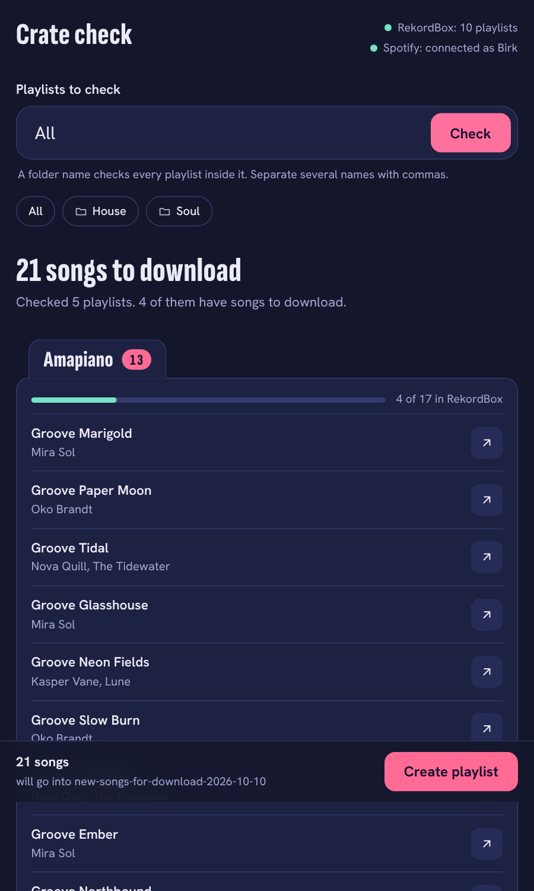
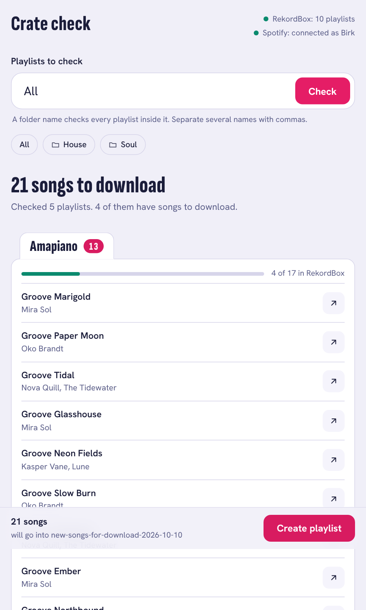

# Crate check

Find the songs in your Spotify playlists that you haven't downloaded into [RekordBox](https://rekordbox.com) yet.

If you collect tracks in Spotify playlists and download them for DJing later, it's hard to keep track of what is still to do. You also want to keep the already downloaded songs in the Spotify playlists, because they feed Spotify's recommendations. Crate check reads your RekordBox library directly, compares it with your Spotify playlists, and can put everything still missing into one new Spotify playlist.

<p>
  
  
</p>

*Example data.*

## What it does

- Reads the RekordBox 6/7 database directly (on a temporary copy; RekordBox itself is never changed).
- Pairs each RekordBox playlist with the Spotify playlist of the same name, including playlists inside RekordBox folders.
- Matches songs fuzzily (accents, "feat.", "- Original Mix" and similar are ignored), but treats remixes, edits and extended mixes as different songs, as a DJ would.
- Shows what's missing per playlist, plus **close matches** to check by eye and songs you own that are filed in **another playlist**.
- Creates `new-songs-for-download-YYYY-MM-DD` in your Spotify account with the missing songs and the close matches.
- Runs as a small local window (`crate_check_ui.py`) or as a command line tool (`crate_check.py`).

## Setup (macOS)

```bash
git clone <this repo> && cd crate-check
python3 -m venv .venv && source .venv/bin/activate
pip install -r requirements.txt
```

If installing `pyrekordbox` complains about SQLCipher: `brew install sqlcipher`, then see the [pyrekordbox docs](https://pyrekordbox.readthedocs.io).

### Spotify access

Every user needs their own free Spotify developer app, so no keys are shared. Since February 2026 Spotify requires **Premium** on the account that owns the app, and each app in development mode can have at most five authorized users.

1. Go to <https://developer.spotify.com/dashboard> and create an app with "Web API" ticked. Don't put "Spotify" or "Spot" at the start of the app name.
2. Redirect URI: `http://127.0.0.1:8888/callback` (exactly this).
3. Under User Management, add your own Spotify account.
4. `export SPOTIPY_CLIENT_ID="<client id>"` (no client secret needed). The first run opens a browser to log in, and the login is cached in your home folder.

No developer app? The command line tool can also read playlists exported with [Exportify](https://exportify.net): `python crate_check.py --csv-dir ~/exportify`.

## Use it

```bash
python crate_check_ui.py
```

Type `All`, a folder name (e.g. `House`, which means every playlist inside it), or several names separated by commas, then press Check. "Create playlist" makes the new playlist (the first time, Spotify asks for one extra permission).

Options: `--plain-tab` (use a normal browser tab), `--no-open` (only print the address), `--rb-db PATH` (non-default RekordBox database, default `~/Library/Pioneer/rekordbox/master.db`), `--folder-name NAME` (the Spotify folder named in the reminder after creating).

Command line:

```bash
python crate_check.py --tree                       # show your RekordBox folders and playlists
python crate_check.py --only "House" "Disco"       # just these playlists or folders
python crate_check.py --only "House" --make-playlist
```

Reports go to `./report/` (`to_download.md`, `.csv`). They contain Spotify song information, so keep them for personal use.

### Optional config files

Copy the examples and edit them (the real files are git-ignored):

- `aliases.json` pairs playlists whose names differ between RekordBox and Spotify.
- `settings.json` has two lists:
  - `skip_folders`: RekordBox folders to leave out when you check `All` (their songs still count as "in RekordBox").
  - `also_check`: Spotify playlists that have no RekordBox twin, such as a dumping ground for songs whose genre you don't know yet. `All` includes them, and you can also type their names. Their songs are compared with your whole RekordBox library, so "missing" means "not anywhere in RekordBox".

## Limits

- **Spotify folders** can't be read or created through Spotify's Web API ([documentation](https://developer.spotify.com/documentation/web-api/concepts/playlists)). Only playlists with a same-named RekordBox playlist are compared, and you drag the new playlist into your Spotify folder yourself.
- Spotify only lets an app read the tracks of playlists the logged-in user owns.
- Matching is fuzzy; that's why close matches are listed and included in the new playlist rather than silently skipped. Tune `MATCH` and `UNSURE` at the top of `crate_check.py`.

## Privacy and safety

- RekordBox's database is copied to a temp folder and only the copy is read.
- The window listens on `127.0.0.1` only, and every request needs a one-time token.
- Only the playlists you ask for are fetched from Spotify. Nothing is sent anywhere except to Spotify's API.

## Development

```bash
pip install -r requirements-dev.txt
python -m pytest
```

## Disclaimer

Not affiliated with, endorsed by or sponsored by Spotify or AlphaTheta (Pioneer DJ). "Spotify" and "RekordBox" are trademarks of their owners. Song information shown in the window comes from Spotify, and every song links back to it. Reading the RekordBox database relies on [pyrekordbox](https://github.com/dylanljones/pyrekordbox); check RekordBox's own terms of use for your situation. Use at your own risk; a library backup is always a good idea.

MIT licensed, see [LICENSE](LICENSE).
